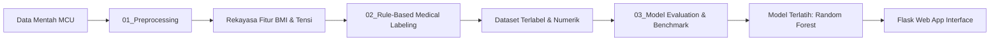

# Sistem Prediksi Kelaikan Kerja Berdasarkan Medical Check-Up (MCU)

[](https://www.python.org/)
[](https://flask.palletsprojects.com/)
[](https://scikit-learn.org/)
[]()

Sistem kecerdasan buatan berbasis *Machine Learning* dan aplikasi web interaktif untuk memprediksi status kelayakan kesehatan kerja (*Occupational Health & Fitness-to-Work Screening*). Sistem ini mengolah data pemeriksaan medis menyeluruh (*Medical Check-Up*), mencakup tanda vital, riwayat penyakit, rekam medis organ vital, hematologi darah lengkap, profil biokimia darah (fungsi hati, ginjal, lipid, gula), hingga urinalisis lengkap.

---

## 📌 Daftar Isi
- [Latar Belakang & Tujuan](#-latar-belakang--tujuan)
- [Klasifikasi Status Kesehatan Kerja](#-klasifikasi-status-kesehatan-kerja)
- [Struktur Repositori](#-struktur-repositori)
- [Benchmark & Performa Model](#-benchmark--performa-model)
- [Alur Kerja (Pipeline ML)](#-alur-kerja-pipeline-ml)
- [Instalasi & Panduan Menjalankan](#-instalasi--panduan-menjalankan)
- [Penggunaan Web Application](#-penggunaan-web-application)
- [Manajemen File Besar di GitHub](#-manajemen-file-besar-di-github)

---

## 🎯 Latar Belakang & Tujuan
Evaluasi kesehatan kerja (*Fit-to-Work Assessment*) merupakan komponen krusial dalam Kesehatan dan Keselamatan Kerja (K3) untuk memastikan pekerja berada dalam kondisi optimal serta mencegah risiko kecelakaan kerja atau perburukan penyakit akibat kerja. 

Proyek ini bertujuan untuk:
1. Mengotomatisasi penentuan status kelaikan kerja berdasarkan puluhan indikator pemeriksaan medis terpadu.
2. Membantu dokter pemeriksa kesehatan kerja dan praktisi HR/K3 dalam mengambil keputusan berbasis data klinis yang konsisten.
3. Menyediakan antarmuka web yang mudah digunakan untuk penginputan hasil MCU serta inferensi status kesehatan secara *real-time*.

---

## 🏷 Klasifikasi Status Kesehatan Kerja
Sistem mengklasifikasikan kondisi pekerja ke dalam 4 kategori status kelaikan:

| Kode | Status | Definisi & Kriteria Klinis |
| :---: | :--- | :--- |
| **0** | **Fit to Work** | Kondisi sehat prima tanpa kelainan klinis atau laboratorium yang signifikan. Pekerja laik ditempatkan di seluruh unit kerja. |
| **1** | **Fit with Note** | Kondisi fisik laik kerja namun ditemukan kelainan ringan/faktor risiko (misal: pra-hipertensi, kolesterol/asam urat batas atas, kelainan urine ringan) yang memerlukan edukasi dan pemantauan berkala. |
| **2** | **Fit with Restriction** | Ditemukan kelainan kesehatan yang membatasi kapasitas kerja (misal: obesitas tingkat lanjut, hipertensi tingkat 2, buta warna, gangguan fungsi spirometri/paru, diabetes tidak terkontrol). Memerlukan penyesuaian beban kerja. |
| **3** | **Unfit** | Kondisi penyakit kritis/berat yang membahayakan diri sendiri atau orang lain (misal: penyakit jantung simtomatik, hepatitis aktif, gangguan jiwa berat, riwayat trauma kepala mayor, hasil uji treadmill positif). Tidak laik bekerja sementara/permanen. |

---

## 📂 Struktur Repositori

```text
sistem-prediksi-kelayakan-kerja-mcu/
├── app.py                         # Server web Flask utama untuk inferensi model
├── requirements.txt               # Daftar pustaka & dependensi Python
├── .gitignore                     # Aturan pengecualian file besar & cache
├── README.md                      # Dokumentasi utama proyek
│
├── templates/                     # Template antarmuka web (HTML)
│   └── index.html                 # Halaman input data MCU & hasil prediksi
│
├── static/                        # Aset statis antarmuka
│   └── style.css                  # Desain styling antarmuka web
│
├── notebooks/                     # Eksperimen Data Science & Machine Learning
│   ├── 01_preprocessing.ipynb     # Pembersihan data, rekayasa fitur BMI & tensi
│   ├── 02_rule_based_labeling.ipynb # Evaluasi rule medis klinis & pelatihan model akhir
│   ├── 03_model_evaluation.ipynb  # Komparasi benchmark 8 algoritma ML
│   └── 04_parameter_reference.ipynb # Tabel referensi kodifikasi & atribut medis
│
├── data/                          # Dataset penelitian
│   ├── README.md                  # Dokumentasi penjelasan dataset
│   ├── sample/                    # Sampel dataset siap pakai (< 2 MB)
│   └── Health_Screening_Fully_Labeled_v3.csv # Data berlabel klinis lengkap (~4.7 MB)
│
├── models/                        # Model Machine Learning
│   ├── README.md                  # Dokumentasi model & panduan pelatihan
│   └── health_status_model_v4.pkl # Model Random Forest terlatih (~362 MB, diabaikan git)
│
├── docs/                          # Dokumen referensi & aturan klinis
│   └── referensi_rekomendasi_medis.php # Aturan interpretasi nilai rujukan lab medis
│
└── archive/                       # Arsip kode & eksperimen versi sebelumnya
    └── legacy_v1/                 # Skrip & notebook versi 1.0
```

---

## 📊 Benchmark & Performa Model
Evaluasi perbandingan dilakukan pada **8 model klasifikasi** dengan pengujian matriks evaluasi (*Accuracy, Precision, Recall, F1-Score*):

| No | Model Algoritma | Accuracy | Precision | Recall | F1-Score |
|:--:| :--- | :---: | :---: | :---: | :---: |
| 1 | **Random Forest** | **1.000000** | **1.000000** | **1.000000** | **1.000000** |
| 2 | **XGBoost Classifier** | **1.000000** | **1.000000** | **1.000000** | **1.000000** |
| 3 | **Artificial Neural Network (ANN / MLP)** | **1.000000** | **1.000000** | **1.000000** | **1.000000** |
| 4 | Gradient Boosting | 0.961679 | 0.932527 | 0.961679 | 0.946147 |
| 5 | K-Nearest Neighbors (KNN) | 0.948779 | 0.951474 | 0.948779 | 0.948539 |
| 6 | Logistic Regression | 0.941603 | 0.947962 | 0.941603 | 0.942559 |
| 7 | Support Vector Machine (SVM) | 0.941029 | 0.935850 | 0.941029 | 0.938215 |
| 8 | Naive Bayes | 0.917481 | 0.933121 | 0.917481 | 0.917444 |

> **Model Terpilih:** **Random Forest Classifier** (`health_status_model_v4.pkl`) dipilih untuk deployment produksi karena stabilitas prediksi, resistansi terhadap *outlier*, dan kecepatan inferensi.

---

## 🔬 Alur Kerja (Pipeline ML)



1. **Preprocessing (`01_preprocessing.ipynb`)**: Menghitung Body Mass Index (BMI) dan mengategorikannya (Underweight, Normal, Overweight, Obesitas I & II), mengonversi nilai sistolik & diastolik ke klasifikasi klinis JNC (Normal, Pra-hipertensi, Hipertensi Tk 1 & 2), serta imputasi data hilang.
2. **Clinical Labeling (`02_rule_based_labeling.ipynb`)**: Menerapkan hierarki penentuan status medis: kondisi fatal/organ vital diarahkan ke *Unfit*, keterbatasan fungsi fisik diarahkan ke *Fit with Restriction*, deviasi ringan parameter lab diarahkan ke *Fit with Note*, dan sisanya *Fit to Work*.
3. **Training & Inference (`app.py`)**: Mengonversi 57 fitur input formulir menjadi vektor numerik dan memprediksi status kesehatan secara instan.

---

## 💻 Instalasi & Panduan Menjalankan

### 1. Kloning Repositori
```bash
git clone https://github.com/username/sistem-prediksi-kelayakan-kerja-mcu.git
cd sistem-prediksi-kelayakan-kerja-mcu
```

### 2. Buat Lingkungan Virtual (Opsional namun Disarankan)
```bash
# Windows
python -m venv venv
venv\Scripts\activate

# Linux / MacOS
python3 -m venv venv
source venv/bin/activate
```

### 3. Instal Dependensi
```bash
pip install -r requirements.txt
```

### 4. Jalankan Aplikasi Web
```bash
python app.py
```
Buka peramban (*browser*) Anda dan akses:
```
http://127.0.0.1:5000/
```

---

## 🌐 Penggunaan Web Application
1. Buka halaman utama aplikasi di peramban.
2. Isi formulir parameter pemeriksaan MCU yang tersedia:
   - Data fisik umum & kategori tekanan darah.
   - Riwayat penyakit & tanda vital (nadi, pernapasan, kesadaran).
   - Tes diagnostik (Spirometri, Treadmill, Audiometri, Foto Thorax).
   - Pemeriksaan darah rutin (Hemoglobin, Leukosit, LED, MCV, dll).
   - Pemeriksaan kimia darah (SGOT, SGPT, BUN, Kreatinin, Asam Urat, Profil Lipid, Glukosa Darah).
   - Pemeriksaan serologi (Hepatitis B: anti-HBs, HBsAg).
   - Urinalisis lengkap (Sedimen, Kimia Urine, Protein, Glukosa, dll).
3. Klik tombol **Predict / Submit**.
4. Hasil prediksi status kelayakan kerja akan langsung ditampilkan pada bagian atas antarmuka.

---

## 📦 Manajemen File Besar di GitHub
Repositori ini dikonfigurasi agar ramah terhadap batas ukuran file GitHub (maksimal 100 MB per file):
* File model berbobot besar (`health_status_model_v4.pkl` ~362 MB) dan dataset raksasa (`>100 MB`) telah otomatis dikecualikan melalui `.gitignore`.
* File sampel siap pakai disertakan dalam folder `data/sample/`.
* Anda dapat melatih kembali model kapan saja dengan mengeksekusi `notebooks/02_rule_based_labeling.ipynb`.
